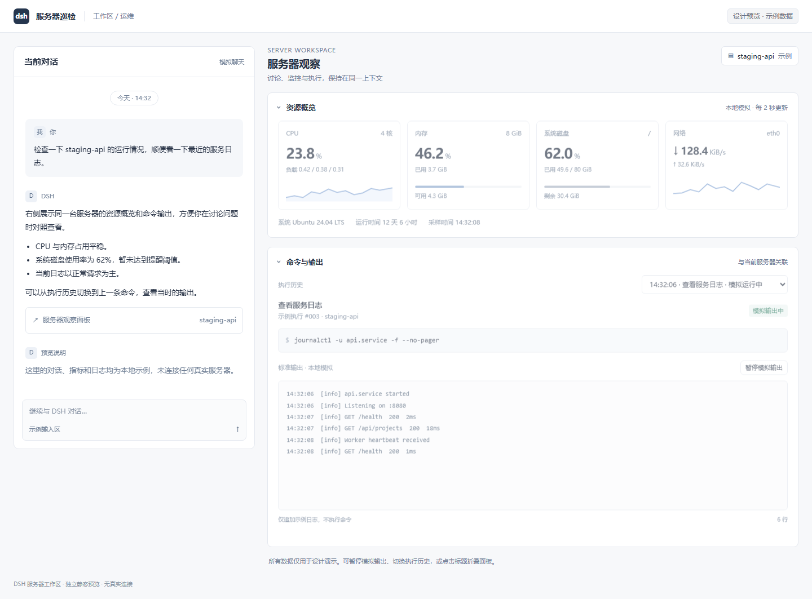

# dsh-server-ops-monitor

DSH 的 SSH Ops 配套面板：在同一个右侧栏里查看当前服务器的只读资源指标，以及 Agent 命令的增量输出。



它不保存 SSH 凭据，也不新增任意远程执行工具。它复用 `dsh-ssh-ops` 已经建立的连接，因此连接、审批、危险命令拦截和原有执行结果仍由 SSH Ops 负责。

## 要求

- DSH `0.2.1-rc.2`（当前验证版本）。
- `dsh-ssh-ops@0.4.1`，并已至少连接一台 Linux 服务器。
- 该连接必须使用 `verify` 主机密钥模式，且目标主机已在 SSH Ops 的 known_hosts 中登记。
- 首版仅支持无跳板机的 Linux 连接。

## 安装

在 DSH 设置 → 插件 → 添加插件中填写本目录，或：

```sh
dsh plugin --profile desktop add link:C:/github/dsh-server-ops
```

重启 DSH 后，打开右侧边栏的 **服务器观察**。

## 使用

1. 在 **SSH 终端** 面板连接服务器，并把该资源的指纹校验模式设为 `verify`。
2. 打开右侧边栏 → **服务器观察**。
3. 选择同一台服务器。CPU、内存、磁盘、网络每 5 秒采样一次。
4. Agent 通过 SSH Ops 执行命令时，面板会显示命令、增量 stdout/stderr、退出码和耗时；可暂停刷新或切换最近执行。

## 安全边界

- 只读采集使用固定 Linux 命令，不接受浏览器输入拼接。
- 监控要求显式 `connectionId`，不会跟随全局“当前服务器”切换，也不会自动重连或重放。
- 执行观察只旁路读取原 SSH 流，不改变命令、参数、审批或原工具结果。
- 活动记录仅保存在当前 DSH 进程内，最多 30 条、每条每流 64 KiB；**不是完整审计**。
- 输出会对常见密码/Token/API Key/Authorization/PEM 私钥模式做尽力脱敏，但不能保证识别所有机密。
- HTTP 接口仅接受当前 DSH 已认证的本机同源请求；不保存密码，不向浏览器返回凭据。
- SSH Ops 0.4.1 的内部服务不是稳定公共 API；升级 SSH Ops 后需要重新验证。

## 验证

```sh
node --test test/*.test.js
```

此外使用本地 `ssh2` 服务端验证过真实 SSH 流：固定采集、CPU/内存/磁盘解析、分块 stdout 观察、退出码与清理。GUI 在隔离 DSH 中以模拟 API 数据验证过指标、历史、暂停和侧栏入口；尚未连接用户的真实 Ubuntu 服务器。

## License

MIT
